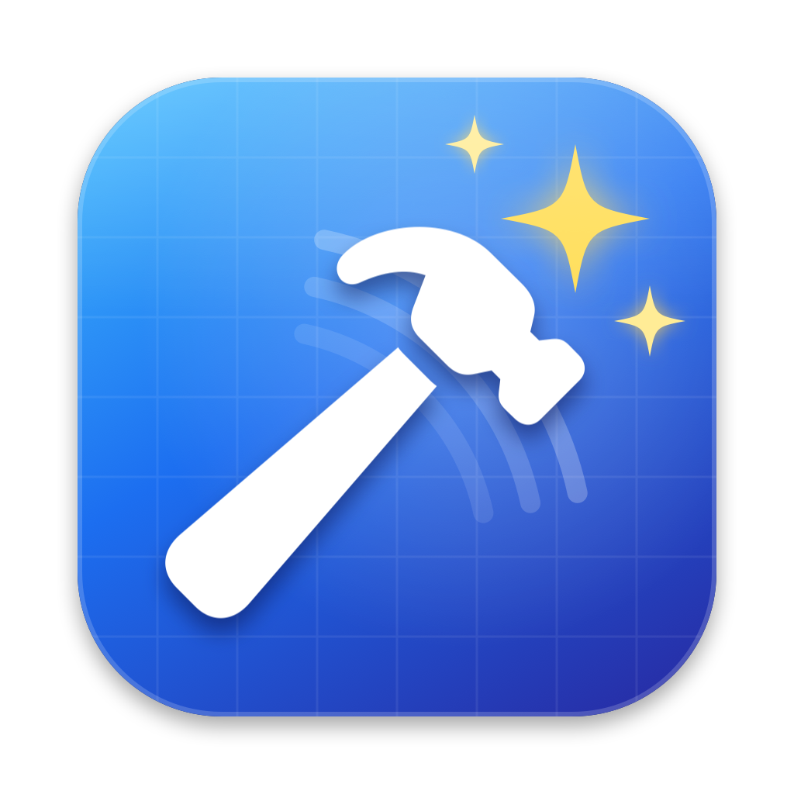
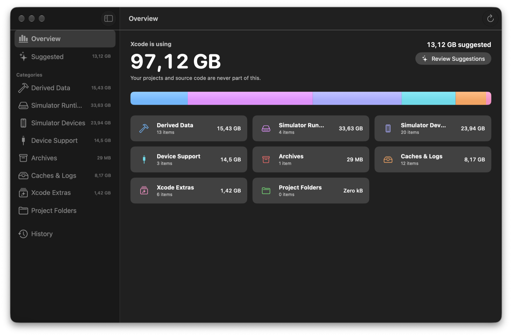

<p align="center">
  
</p>

# XcodePimp

A native macOS app that reclaims the disk space Xcode quietly eats — derived data, simulator runtimes and devices, device support files, caches and more — **without ever touching your projects**.



Xcode keeps tens of gigabytes of regenerable data in `~/Library/Developer`. XcodePimp shows where it all goes, suggests what is stale, and removes only what you tick. It was inspired by the long-archived [XcodeCleaner](https://github.com/waylybaye/XcodeCleaner), rewritten from scratch in SwiftUI and brought up to date with how current Xcode versions store their data.

## What it cleans

| Category | What it is | How it is removed |
|---|---|---|
| **Derived Data** | Build products, indexes and module caches, listed per project. Projects whose folder no longer exists are flagged. | Trash |
| **Simulator Runtimes** | Downloaded simulator OS images (now stored as cryptex disk images). | `xcrun simctl runtime delete` |
| **Simulator Devices** | Individual simulators and their app data, plus the preview and parallel-testing device sets. | `xcrun simctl delete` |
| **Device Support** | Debug symbols copied from every iPhone, iPad, Watch, Apple TV or Vision Pro you connected. | Trash |
| **Archives** | `.xcarchive` bundles with app name, version and date. Never preselected. | Trash |
| **Caches & Logs** | Documentation cache, Swift Package Manager, CocoaPods and Carthage caches, Xcode tool caches, simulator and device logs. | Trash (contents only) |
| **Xcode Extras** | Old versions of Xcode's coding-assistant agent that the selected Xcode no longer uses. | Trash |
| **Project Folders** | `.build`, `build`, `DerivedData`, `Pods` and `Carthage/Build` inside folders you choose. | Trash |

Some things are shown with their size but cannot be removed from the app, because Xcode or the system owns them: the simulator dyld caches under `/Library/Developer` (they disappear when their runtime is deleted) and Organizer data.

## Safety

Every file deletion passes through a single gate, [`SafetyGuard`](XCodePimp/Core/SafetyGuard.swift):

- **Allowlist only.** An item must be strictly inside a fixed list of Xcode folders. The folders themselves are never removed.
- **No symlinks, no mount points.** Symbolic links and anything on a different volume from its parent are refused.
- **Protected paths.** `Xcode/UserData` (provisioning profiles, key bindings, snippets, coding-assistant history), CoreDevice and signing material are never offered.
- **Simulators go through `simctl`.** Only a fixed set of command shapes can run, and a running simulator cannot be deleted.
- **Project folders are conservative.** A build folder is listed only when it sits next to the project file that produces it and is not tracked by git. Source files are never listed.
- **Risk levels.** Each item is marked *Safe* (rebuilt automatically), *Caution* (needs a download or loses local data) or *Keep* (cannot be regenerated). Only Safe items are ever preselected.
- **Trash by default**, a confirmation sheet before anything happens, and a dry-run mode that only logs what would be removed.

## Usage

1. Launch XcodePimp. It scans immediately and shows the total on the **Overview**.
2. Open **Suggested** (or click *Review Suggestions*) to see stale, orphaned and superseded items. Risk-free ones are ticked for you; anything that needs a re-download is left for you to decide.
3. Or open any category, sort the table by size or last-used date, and tick what you want gone.
4. Click **Clean…**, check the confirmation sheet, and confirm.
5. Files land in the Trash — empty it to actually free the space. Simulators and runtimes are removed by `simctl` and do not go to the Trash.

Other things worth knowing:

- **Right-click** a row to reveal it in Finder, copy its path, or erase a simulator's content instead of deleting it.
- **Project Folders** is empty until you add the folders where you keep your code (in the category itself or in Settings).
- **Settings** (⌘,) holds the staleness threshold for suggestions, permanent delete instead of Trash, and dry run.
- **History** records everything the app removed, or would have removed in a dry run.
- Quit Xcode before cleaning Derived Data, or expect a full rebuild and re-index of open projects.

## Requirements

- macOS 15 or later
- Xcode installed (the app uses `xcrun simctl` for simulators and runtimes)

The app is **not sandboxed**: it needs to read `~/Library/Developer` and run `simctl`, which the App Sandbox does not allow.

## Building

You need Xcode 16 or later (developed with Xcode 27.2, Swift 6).

```bash
git clone https://github.com/portwally/XCodePimp.git
cd XCodePimp
open XCodePimp.xcodeproj
```

Then press **Run** (⌘R). The project signs for local running only; set your own team under *Signing & Capabilities* if you want to distribute a build.

From the command line:

```bash
xcodebuild -project XCodePimp.xcodeproj -scheme XCodePimp -destination 'platform=macOS' build
```

Run the unit tests:

```bash
xcodebuild -project XCodePimp.xcodeproj -scheme XCodePimp -destination 'platform=macOS' test
```

The tests work on throwaway fixture folders and never touch your real Xcode data.

### Regenerating the project

`XCodePimp.xcodeproj` is generated from [`project.yml`](project.yml) with [XcodeGen](https://github.com/yonaskolb/XcodeGen). After adding or moving source files:

```bash
xcodegen generate
```

### Regenerating the icon

The app icon is drawn by a script:

```bash
swift Design/make-icon.swift Design/AppIcon-1024.png
```

## Project layout

```
XCodePimp/
  App/            app entry point and the observable app model
  Core/           item model, paths, SafetyGuard, Remover, size calculation, simctl wrapper
  Scanners/       one scanner per category
  Suggestions/    rules for the Suggested view
  Views/          SwiftUI interface
XCodePimpTests/   unit tests (Swift Testing)
Design/           icon script, icon master, screenshot
```

## Disclaimer

XcodePimp deletes files. It is built to be careful, but use it at your own risk and keep backups of anything you cannot regenerate — archives in particular.

## License

MIT — see [LICENSE](LICENSE).
